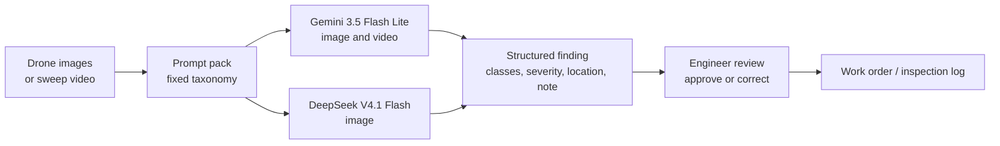

# Blade Inspection Copilot


Multimodal triage and report drafting for wind turbine blade inspections.

A drone captures hundreds of blade images per turbine. An engineer still writes a finding for each one: defect type, severity, location, action. This project measures whether a multimodal model can draft that finding reliably enough to cut documentation time, and compares a frontier-quality model against a cheap one on the same real inspection images.

## Results

75 real drone images, fixed six-class taxonomy, one call per image.

| model | exact set match | class-set F1 | critical recall | cost / 1,000 | p50 |
|---|---|---|---|---|---|
| Gemini 3.5 Flash Lite | 21.3% | 0.360 | 69.2% | $0.46 | 1.96s |
| DeepSeek V4.1 Flash | 9.3% | 0.169 | 7.7% | $0.40 | 6.59s |

Critical recall counts crack and thunderstrike together. Exact set match requires the model to name exactly the annotated class set.

Reading:

1. Gemini is usable as a drafting copilot, not as a gate. Seven in ten critical defects are caught and the draft is usually in the right family of classes. A human still approves every image.
2. DeepSeek at similar cost is not viable for this task. Fine surface defects are where its visual grounding breaks down.
3. Cost is not the decision variable. Both are under half a dollar per thousand images, against minutes of engineer time per finding.

Report with figures and an interactive business calculator: `reports/report.html`.

## Video

Gemini 3.5 Flash Lite accepts video directly. An eight-second sweep built from eight held-out frames produced a per-second condition log with 3 of 5 critical frames flagged, at the same cost per frame. See the report for the frame table.

## Architecture



## Technology stack

- Python 3.13, `uv`
- Gemini 3.5 Flash Lite via the Gemini API, image and video input
- DeepSeek V4.1 Flash via an OpenAI-compatible gateway
- Pillow, numpy, matplotlib for data prep, metrics and figures
- Themed HTML report with an interactive calculator

## Repository layout

- `src/gridinspect`: providers, prompts, dataset loader, evaluation and metrics
- `scripts/run_eval.py`: measured grid across models
- `scripts/build_video.py`: sweep video and per-second evaluation
- `scripts/report.py`: report, figures, thumbnail
- `scripts/classify.py`: single-image CLI
- `reports/report.html`: the study document
- `docs/method.md`: protocol, taxonomy, threats

## Quick start

```bash
uv sync
# put HBC_GO_API_KEY and GEMINI_API_KEY in keys.env
uv run python scripts/run_eval.py --model both --per-class 13
uv run python scripts/build_video.py
uv run python scripts/report.py
uv run python scripts/classify.py path/to/blade.jpg
```

## Data

Wind Turbine Blade Defect dataset, DOI 10.6084/m9.figshare.30210175, CC BY 4.0. 1,065 annotated drone images, six defect classes. The dataset contains only defective blades, so specificity and false-clear rate cannot be reported from it.

## Honest framing

- No healthy class in the source data, so this study cannot claim an auto-clear rate.
- 75 images, one seed, and one annotation source. Intervals are wide.
- Craze versus hide_craze is an ambiguous boundary even for annotators.
- p95 latency includes gateway retries.
- The copilot drafts findings. It does not approve them.

## License

Code Apache-2.0. Dataset CC BY 4.0, attributed in the report.
