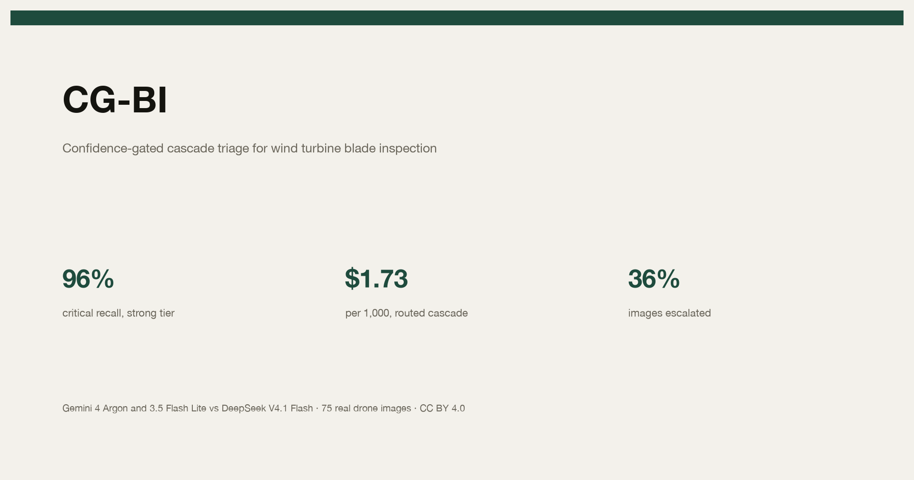
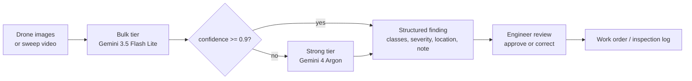

# CG-BI



Confidence-gated cascade triage for multimodal wind turbine blade inspection.

A drone captures hundreds of blade images per turbine. An engineer still writes a finding for each one: defect type, severity, location, action. This project measures whether a multimodal model can draft that finding, and what a two-tier routing policy buys over picking one model.

## Results

75 real drone images, fixed six-class taxonomy, one call per image unless escalated.

| tier | exact set | class F1 | critical recall | cost / 1,000 | p50 |
|---|---|---|---|---|---|
| Gemini 3.5 Flash Lite | 17.3% | 0.323 | 50.0% | $0.43 | 1.33s |
| Gemini 4 Argon via gateway | 14.7% | 0.417 | 96.2% | $3.64 | 5.71s |
| DeepSeek V4.1 Flash | 9.3% | 0.169 | 7.7% | $0.40 | 6.59s |
| **Routed cascade** | **25.3%** | **0.424** | **92.3%** | **$1.73** | 4.01s |

The cascade runs the cheap tier on every image and escalates the 36 percent whose own confidence falls below 0.9 to the strong tier.

Reading:

1. The cascade beats both single tiers on exact match and F1, holds 92 percent critical recall, and costs 47 percent of the strong tier alone.
2. Tier choice is not the lever, routing is. The strong tier alone is accurate on critical defects but expensive; the cheap tier alone misses half of them.
3. DeepSeek V4.1 Flash is not viable for this task at a similar price. Cheap image input does not buy visual grounding.

Report with figures, the cascade table, video results and an interactive business calculator: `reports/report.html`.

## Video

Gemini accepts video directly. An eight-second sweep built from eight held-out frames produced a per-second condition log with 3 of 5 critical frames flagged. Frame table is in the report.

## Architecture



## Technology stack

- Python 3.13, `uv`
- Gemini 3.5 Flash Lite via the Gemini API, image and video input
- Gemini 4 Argon and DeepSeek V4.1 Flash via an OpenAI-compatible gateway
- Pillow, numpy, matplotlib for data prep, metrics and figures
- Themed HTML report with an interactive calculator

## Repository layout

- `src/cgbi`: providers, prompts, dataset loader, evaluation and metrics
- `scripts/run_eval.py`: per-model evaluation
- `scripts/cascade.py`: confidence-gated routing frontier
- `scripts/build_video.py`: sweep video and per-second evaluation
- `scripts/examples.py`: annotated case panels and the video strip
- `scripts/report.py`: report, figures, thumbnail
- `scripts/classify.py`: single-image CLI
- `reports/report.html`: the study document
- `docs/method.md`: protocol, taxonomy, threats

## Quick start

```bash
uv sync
# keys.env with GEMINI_API_KEY and HBC_GO_API_KEY
uv run python scripts/run_eval.py --model both --per-class 13
uv run python scripts/cascade.py
uv run python scripts/build_video.py
uv run python scripts/report.py
uv run python scripts/classify.py path/to/blade.jpg
```

## Data

Wind Turbine Blade Defect dataset, DOI 10.6084/m9.figshare.30210175, CC BY 4.0. 1,065 annotated drone images, six classes. The dataset contains only defective blades, so specificity and false-clear rate cannot be reported from it.

## Honest framing

- No healthy class in the source data, so no auto-clear claim.
- 75 images, one seed, one annotation source.
- Craze versus hide_craze is ambiguous even for annotators.
- p95 includes gateway retries.
- The cascade improves what the reviewer sees and at what cost; it does not remove the review.

## License

Code Apache-2.0. Dataset CC BY 4.0, attributed in the report.
